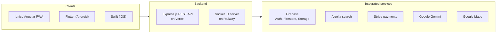

 

[portfolio](https://www.test-plus.work/en) / [linkedin](https://www.linkedin.com/in/test-plus-004601285/) / [youtube](https://youtube.com/playlist?list=PLkzUf67y42SM-JlZk4eJEDIYPdb7VKbVo) / [email](mailto:baldwon0xd@gmail.com)

## Hi, I'm Baldwin ヾ(＾∇＾)

I'm a developer from Hong Kong. Mostly I build apps for the web and for phones, plus the backends behind them, and I make games in Unity whenever I get the chance. Lately I've been writing a lot of Python too (local LLM stuff and computer vision, more on that further down).

The thing I'm proudest of is Pour Rice (倒米), a vegetarian restaurant finder I built by myself for my final year project. It runs as a web app, an Android app and an iOS app that all talk to the same backend.

Ask me about sharing one backend between Ionic, Flutter and Swift clients, real-time stuff with Socket.IO, or getting services running in Docker behind NGINX.

繁體中文

 

香港專業進修學校電腦學高級文憑（流動應用及遊戲開發）畢業生，具備涵蓋網頁、Android 及 iOS 平台的全端開發實務經驗。

曾獨立設計、開發並部署 PourRice（倒米），一個涵蓋前端、後端、即時系統及第三方服務整合的全端餐廳搜尋平台。除手機應用及遊戲開發外，亦持續探索本地大型語言模型及電腦視覺。

## What I use

Languages first, then everything else.

web and mobile:         

backend and cloud:             

games:    

python and ML:           

testing:      

tools:    

AI tools:  ![Codex](https://img.shields.io/badge/Codex-10A37F?style=flat-square&logo=data%3Aimage%2Fsvg%2Bxml%3Bbase64%2CPHN2ZyB4bWxucz0iaHR0cDovL3d3dy53My5vcmcvMjAwMC9zdmciIHZpZXdCb3g9IjAgMCAyNCAyNCIgd2lkdGg9IjI0IiBoZWlnaHQ9IjI0Ij48cGF0aCBmaWxsPSIjZmZmIiBmaWxsLXJ1bGU9ImV2ZW5vZGQiIGQ9Ik04LjA4Ni40NTdhNi4xMDUgNi4xMDUgMCAwMTMuMDQ2LS40MTVjMS4zMzMuMTUzIDIuNTIxLjcyIDMuNTY0IDEuN2EuMTE3LjExNyAwIDAwLjEwNy4wMjljMS40MDgtLjM0NiAyLjc2Mi0uMjI0IDQuMDYxLjM2NmwuMDYzLjAzLjE1NC4wNzZjMS4zNTcuNzAzIDIuMzMgMS43NyAyLjkxOCAzLjE5OC4yNzguNjc5LjQxOCAxLjM4OC40MjEgMi4xMjZhNS42NTUgNS42NTUgMCAwMS0uMTggMS42MzEuMTY3LjE2NyAwIDAwLjA0LjE1NSA1Ljk4MiA1Ljk4MiAwIDAxMS41NzggMi44OTFjLjM4NSAxLjkwMS0uMDEgMy42MTUtMS4xODMgNS4xNGwtLjE4Mi4yMmE2LjA2MyA2LjA2MyAwIDAxLTIuOTM0IDEuODUxLjE2Mi4xNjIgMCAwMC0uMTA4LjEwMmMtLjI1NS43MzYtLjUxMSAxLjM2NC0uOTg3IDEuOTkyLTEuMTk5IDEuNTgyLTIuOTYyIDIuNDYyLTQuOTQ4IDIuNDUxLTEuNTgzLS4wMDgtMi45ODYtLjU4Ny00LjIxLTEuNzM2YS4xNDUuMTQ1IDAgMDAtLjE0LS4wMzJjLS41MTguMTY3LTEuMDQuMTkxLTEuNjA0LjE4NWE1LjkyNCA1LjkyNCAwIDAxLTIuNTk1LS42MjIgNi4wNTggNi4wNTggMCAwMS0yLjE0Ni0xLjc4MWMtLjIwMy0uMjY5LS40MDQtLjUyMi0uNTUxLS44MjFhNy43NCA3Ljc0IDAgMDEtLjQ5NS0xLjI4MyA2LjExIDYuMTEgMCAwMS0uMDE3LTMuMDY0LjE2Ni4xNjYgMCAwMC4wMDgtLjA3NC4xMTUuMTE1IDAgMDAtLjAzNy0uMDY0IDUuOTU4IDUuOTU4IDAgMDEtMS4zOC0yLjIwMiA1LjE5NiA1LjE5NiAwIDAxLS4zMzMtMS41ODkgNi45MTUgNi45MTUgMCAwMS4xODgtMi4xMzJjLjQ1LTEuNDg0IDEuMzA5LTIuNjQ4IDIuNTc3LTMuNDkzLjI4Mi0uMTg4LjU1LS4zMzQuODAyLS40MzguMjg2LS4xMi41NzMtLjIyLjg2MS0uMzA0YS4xMjkuMTI5IDAgMDAuMDg3LS4wODdBNi4wMTYgNi4wMTYgMCAwMTUuNjM1IDIuMzFDNi4zMTUgMS40NjQgNy4xMzIuODQ2IDguMDg2LjQ1N3ptLS44MDQgNy44NWEuODQ4Ljg0OCAwIDAwLTEuNDczLjg0MmwxLjY5NCAyLjk2NS0xLjY4OCAyLjg0OGEuODQ5Ljg0OSAwIDAwMS40Ni44NjRsMS45NC0zLjI3MmEuODQ5Ljg0OSAwIDAwLjAwNy0uODU0bC0xLjk0LTMuMzkzem01LjQ0NiA2LjI0YS44NDkuODQ5IDAgMDAwIDEuNjk1aDQuODQ4YS44NDkuODQ5IDAgMDAwLTEuNjk2aC00Ljg0OHoiLz48L3N2Zz4%3D)   

## Pour Rice 倒米 (◕ᴗ◕✿)

It helps people in Hong Kong find vegetarian restaurants, book tables and ask questions about menus. Restaurant owners get their own side of the app too, so they can chat with diners, take bookings and pay to promote their place. Everything works in English and Traditional Chinese.

Under the hood there's native Google sign-in, push notifications for reservation updates, a Gemini-powered assistant that answers questions about a restaurant's menu, live diner-to-owner chat over Socket.IO, QR codes that deep link straight to a menu, Stripe for the ads, and Google Maps plus Algolia for finding places nearby. I did the architecture, the clients, the backend, the real-time server, the integrations and the deployment myself.

Roughly how it fits together (not every request path is drawn):

The main client is the Ionic/Angular web app ([code](https://github.com/Test-Plus-XD/Cross-Platform-Assignment), or [try it live](https://cross-platform-assignment.vercel.app/home)). The Android version is in Flutter ([code](https://github.com/Test-Plus-XD/Android-Assignment)) and the iOS one is native Swift ([code](https://github.com/Test-Plus-XD/iOS-Assignment)). The Flutter app alone is about 21,000 lines of Dart over 100 files, with 45 unit tests and all of them passing.

(☞ﾟヮﾟ)☞ demos: [overview with the live backend](https://youtu.be/SsHJJNL3MKs), [technical overview](https://youtu.be/CTI5XFZ7POQ), [the PWA](https://youtu.be/DMCyLYqmvcw)

## Other things I've built

- [RAG-vis-Python](https://github.com/Test-Plus-XD/RAG-vis-Python) is a Q&A bot that runs entirely offline. LangGraph decides whether to search my own documents (stored in Chroma) or just answer, and the model is a local Qwen running through Ollama.
- A 2D tactics game in Unity ([code](https://github.com/Test-Plus-XD/2D-Chess-Project), [demo](https://youtu.be/oeiCjfTcAOY)). It's chess-ish and turn-based on a hex grid, then mixes in SUPERHOT-style real-time combat. The AI weighs up spatial advantage and I used raycasts for line of sight.
- A 2D puzzle game, also Unity, with animations, scoring and a few difficulty levels ([code](https://github.com/Test-Plus-XD/2D-Puzzle-Game-Assignment), [demo](https://youtube.com/shorts/03PpUxeYq78)).
- A 3D mobile game with custom models made in 3ds Max (gameplay: [shooter](https://youtu.be/Rf3YQ5JqGh8), [runner](https://youtube.com/shorts/TjW_fJ801HU)).
- A Steam-style store in PHP and MySQL with Bootstrap 5 ([code](https://github.com/Test-Plus-XD/Web-Assignment), [demo](https://youtu.be/RHIbLWDbQuY)).
- An AI dataset annotation tool that I wrote test-first, in Next.js and TypeScript with Jest, Mocha and Playwright ([code](https://github.com/Test-Plus-XD/Software-Engineering-Git-Assignment/tree/main/AI%20Annotation%20Tool%20v2), [demo](https://youtu.be/mgE3mYxxpYw)).
- [My portfolio site](https://www.test-plus.work/en) ([code](https://github.com/Test-Plus-XD/Curriculum-Vitae-on-Vercel)): Next.js, English and Traditional Chinese, with a custom text animation that switches itself off for people who prefer reduced motion, and property-based tests.
- Linux server admin coursework: WireGuard VPN tunnels between Ubuntu VMs (IPv4 forwarding, chained tiers) and containerised NGINX built from custom Dockerfiles ([presentation](https://youtu.be/U9pubOUTG-8)).
- A card-matching game in Java Swing with flip animations and audio ([code](https://github.com/Test-Plus-XD/NetBeans-Projects/tree/main/CardMatchingGame), [demo](https://youtu.be/yxGm6arDMzs)).
- [Computer-Science-Lab](https://github.com/Test-Plus-XD/Computer-Science-Lab) is my practice repo: C++ exercises, Java, HTML and CSS, Access databases, and Python notebooks on NumPy, Matplotlib and Keras (perceptron, XOR, MNIST).

## What I'm poking at now (｀・ω・´)

- Local LLM apps. The RAG bot above is the start of it.
- Robust object detection in difficult visual conditions, with friends at HKMU, using Ultralytics YOLO and PyTorch.
- The Gemini API from Python, alongside using it in Pour Rice.

## How I like to work

I try to write tests where they matter (the annotation tool was test-first, the Flutter app has its unit tests, the portfolio uses property-based ones), keep the logic in one backend instead of copying it into three clients, and make things work in both English and Traditional Chinese. I also try to respect reduced-motion settings and to caption my presentations.

## The boring bits ( ˘▽˘)

I finished a Higher Diploma in Computer Studies (Mobile Applications and Game Development) at the Hong Kong College of Technology in 2026, with a CGPA of 3.8. Back at school I took part in the 3rd S.K.H. Secondary Schools Robot Competition (2020 to 2021), where I designed robots and their control programmes and made an early attempt at getting them to read road signs with AI.

I speak Cantonese (native), English and some Mandarin.

That's about it. Say hi if you want to talk code (⌒‿⌒)

Banner lettering is Tektur by Adam Jagosz, used under the SIL Open Font License.
